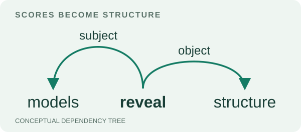

# Dependency parsing: scores become structure

<picture>
  <source media="(prefers-color-scheme: dark)" srcset="assets/parsing-dark.svg">
  
</picture>

How do local edge scores become a globally valid dependency tree? This project connects an averaged-perceptron parser, a corrected Chu–Liu/Edmonds decoder, and experiments that read syntax from frozen BERT attention. It began as joint coursework by **Roee Tekoah and Yona Gan**; this standalone edition adds independent correctness evidence, explicit experiment configurations, and a small reproduction route.

The useful engineering lesson is in the decoder: a tree can look valid while optimizing the wrong edges. Cycle contraction must preserve the real endpoints of both entering and leaving edges. A four-node example exposes the original supplied decoder's reconstruction error: it returns cost **16**, while the optimum is **12**. The corrected coursework decoder retains the missing endpoint; the release makes its input contract explicit and checks optimality against exhaustive enumeration.

## Try it without a corpus or model

Python 3.11 or later; the core package has no third-party runtime dependencies.

```text
python -m pip install .
python -m dependency_parsing demo
```

The demo trains and evaluates on three authored sentences. It exercises feature scoring, averaged-perceptron updates, decoding, and evaluation; its score is a **smoke check, not a held-out result**.

```text
python -m pip install ".[test]"
python -m pytest -q
```

The test suite enumerates **19,683** sparse, weighted four-node graphs and checks another **600** seeded graphs of up to six nodes against an independent exhaustive oracle. It also covers nested contraction, unreachable nodes, negative weights, ties, ROOT restrictions, lazy averaging versus an explicit average, and subword/attention alignment. This is bounded correctness evidence, not a proof for every input size.

## The three pieces

1. **Structured prediction.** Each candidate head→dependent edge fires a word-pair feature and a POS-pair feature. An averaged perceptron updates the difference between gold and predicted trees. A maximum-scoring arborescence is obtained by negating edge scores for the minimum-cost decoder. Gold POS tags are supplied at evaluation time.
2. **Contraction and reconstruction.** The corrected decoder records the target of an edge entering a cycle and the source of an edge leaving it. This release also adds deterministic ties, sparse/infeasible-graph handling, and an iterative contraction stack. It allows non-projective trees and multiple children of the artificial ROOT; it does not enforce exactly one syntactic root.
3. **Attention as a feature source.** Training-free probes compare head-mean attention at layers 0, 5, and 11. Additional experiments select an individual head on a training subset or learn a linear combiner from forward and backward attention values. BERT remains frozen. These experiments measure what the readout predicts; they do not establish a causal explanation of syntax.

See the [decoder contract and reasoning](docs/decoder.md), [experiment ledger](docs/experiments.md), and [contribution/edition record](docs/provenance.md).

## Recorded coursework results

These are historical **sentence-macro UAS**, including punctuation, on a fixed 3,522/392 sentence split of NLTK's dependency treebank. They are not standard token-micro UAS or leaderboard comparisons. This extraction preserves their provenance rather than presenting them as fresh release benchmarks.

| Experiment | Historical test UAS | Evidence |
|---|---:|---|
| Perceptron, both features, seed 0 | 0.4050 | Saved results log |
| Perceptron, seeds 0–4 | 0.4015 ± 0.0049 | Report; sample standard deviation |
| Frozen BERT, mean heads, layer 0 | 0.2376 | Saved results log |
| Frozen BERT, mean heads, layer 5 | 0.1856 | Saved results log |
| Frozen BERT, mean heads, layer 11 | 0.1304 | Saved results log |
| Single head L3/H5, selected on first 250 training sentences | ≈0.278 | Report only; also identified as the test oracle there |
| Learned linear attention combiner, first 300 training sentences | ≈0.601 | Report only |

The middle-layer hypothesis did not hold for the tested mean-head readout. The report's learned-combiner result suggests a stronger supervised readout, but it has no recovered raw run log, repeated seeds, validation sweep, or uncertainty estimate. It uses a different feature set and less labeled training data than the perceptron. The comparison is exploratory, and the table does not support state-of-the-art claims or a causal account of why any layer performs better.

## Checked release run

The standalone edition was also run locally on the full classical split (Python 3.13.13, 11 October 2026): **0.4108 ± 0.0025** sentence-macro UAS across seeds 0–4, sample SD. Seed 0 gives **0.4127 macro / 0.3700 micro UAS**. The original edition independently reproduces its saved seed-0 result, 0.4050; both loaders return identical examples. The release changes deterministic tie choices, so these are separate edition results, not a claimed accuracy improvement. The five-seed run took approximately 129 seconds on the checked machine. [Full run record](experiments/release-classical-run.json).

Seed-0 token-weighted diagnostics show lower attachment accuracy on sentences longer than 20 tokens (0.3246) than on sentences of at most 10 tokens (0.6335). This is a descriptive breakdown of this split, not a controlled length effect; the [record](experiments/release-classical-run.json) includes counts, ROOT decisions, and gold-distance bins.

Historical supplied-decoder comparisons are retained in [machine-readable tables](experiments/historical-results.csv). That perceptron comparison retrains with the alternative decoder, so it changes both training trajectories and inference; it does not isolate a test-time decoder effect.

## Reproduce a real experiment

The [reproduction guide](docs/reproduction.md) separates the local classical route from model downloads and attention experiments. Each experiment has one JSON configuration and writes a structured record with configuration hash, corpus fingerprint, package versions, metric, and elapsed time. The release uses deterministic decoder ties; a new run can differ from the historical edition's tie choices. Historical model revision and dependency versions were not recorded, so exact numerical reproduction is not promised.

## Scope, credit, and distribution

This is a focused research/engineering portfolio project, not a production parser. It lacks dependency labels, a learned POS tagger, modern parser baselines, multilingual evaluation, and an independent validation split. Attention ROOT scores use a [CLS] proxy; ROOT has a zero reverse-attention column. Inputs exceeding the model's token limit fail rather than being silently truncated.

The coursework credits Roee Tekoah and Yona Gan jointly. Available records do not establish a person-by-person implementation split, so this repository does not attribute the decoder correction or attention extensions solely to either author. The assignment prescribed the baseline features, split, and training settings and supplied a decoder and attention extractor. Those supplied files are excluded, and their role is documented in [provenance](docs/provenance.md). Packaging, additional validation, the new interface, and the conceptual visual are later, AI-assisted release work.

No corpus text, model weights, assignment PDFs, student identifiers, submission archives, or copied third-party scaffolding are included. No blanket open-source license is asserted; see [rights and third-party boundaries](RIGHTS.md).

The arc illustration is conceptual, not model output or an experiment plot. The broader NLP course collection should link here rather than duplicate this implementation.
